# OrbitFit

**Health monitoring for crews far from Earth. Works fully offline.**

NASA Space Apps Challenge 2026 · *Create Health Monitoring Software for Astronauts on Space Missions*

Halfway to Mars, the doctors on Earth are minutes away and sometimes out of contact, and most astronauts are not
doctors. OrbitFit turns one laptop into a crew health station: a daily check-in, vital signs, a camera workout
that counts reps, alerts that say what to do, emergency steps that change with gravity, forecasts, and a report
sent to Earth when the link opens.

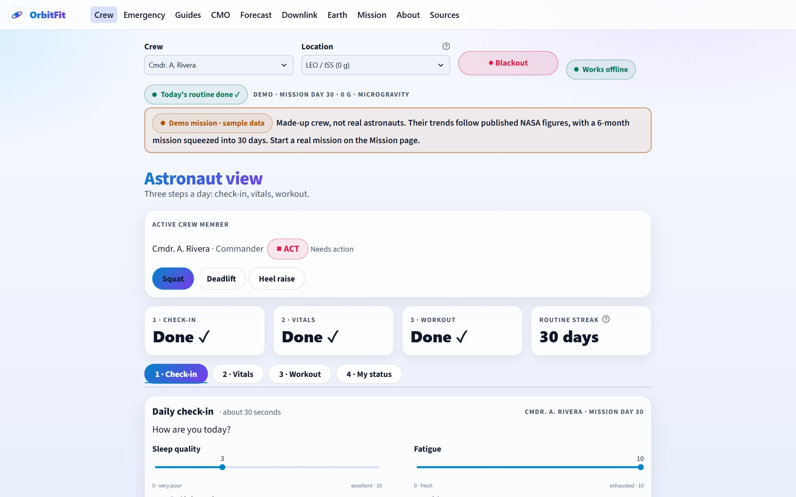

**▶ [Watch the demo video](https://drive.google.com/file/d/1djFboQ6O8qQLctbERtOGhY7Jhwdl2wvl/view?usp=sharing)** (Google Drive)

> Prototype decision-support tool. Not a medical device. Thresholds are demonstration values, not clinically validated.

## Contents

[Demo videos](#demo-videos) · [Screenshots](#screenshots) · [Features](#features) ·
[How to run locally](#how-to-run-locally) · [Try it in 2 minutes](#try-it-in-2-minutes) ·
[How it works](#how-it-works) · [NASA data](#nasa-data-and-resources) · [Project structure](#project-structure) ·
[Tests](#tests) · [Team](#team-and-licence)

## Demo videos

| Video | What it shows |
|---|---|
| [**Demo video** (Google Drive)](https://drive.google.com/file/d/1djFboQ6O8qQLctbERtOGhY7Jhwdl2wvl/view?usp=sharing) | The project demo submitted to NASA Space Apps |
| [30-second demo](docs/videos/orbitfit-demo-30s.mp4) | "Halfway to Mars": an emergency, the daily routine, a trend alert with a forecast, the crew view and a report to Earth |
| [Live walkthrough (under 2 min)](docs/videos/orbitfit-live-walkthrough.mp4) | A real screen recording: a new mission is set up and dummy values are typed in, then the camera workout, the gravity slider, emergency, forecast, a report reaching Earth and the logbook |

## Screenshots

| | |
|---|---|
| 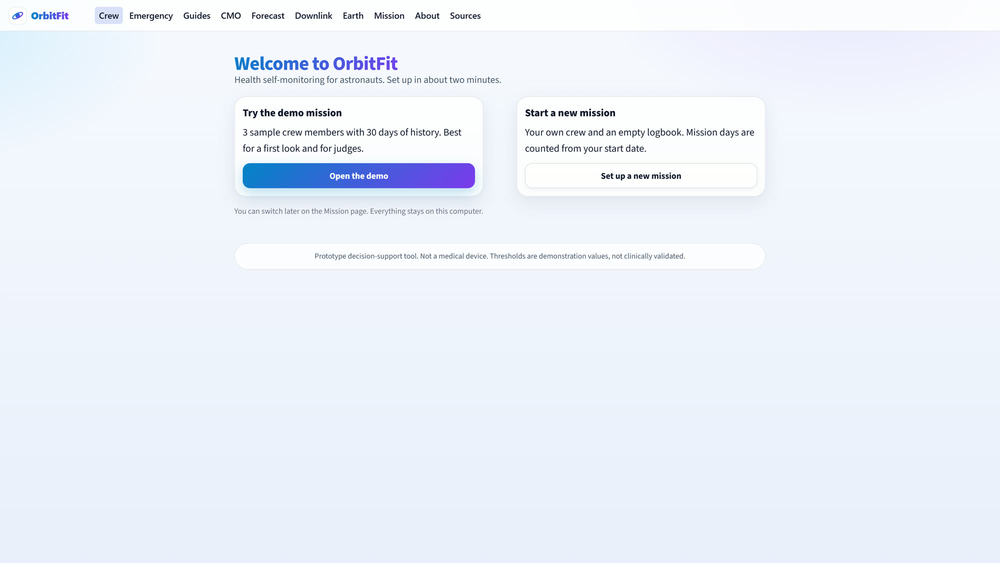 **First start:** open the demo or set up a real mission | 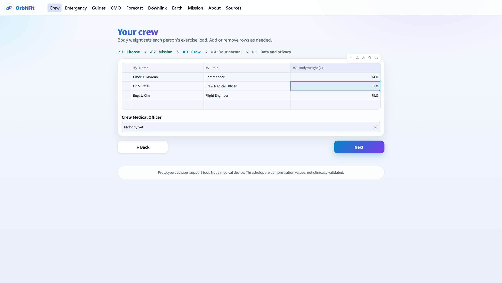 **Your crew:** names, roles and body weights |
| 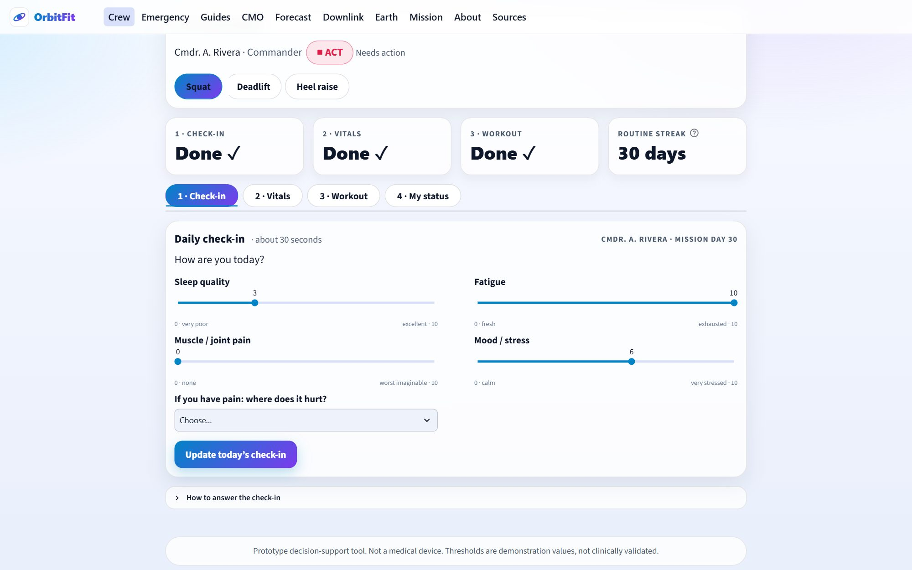 **Daily check-in:** sleep, fatigue, pain and stress in 30 seconds | 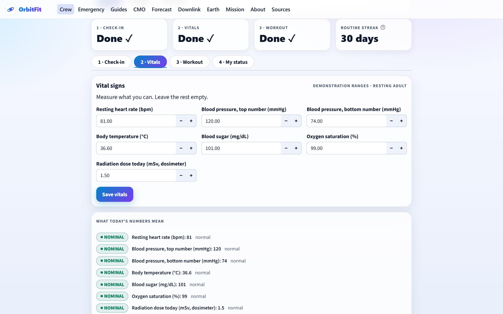 **Vital signs and radiation**, each explained at once |
| 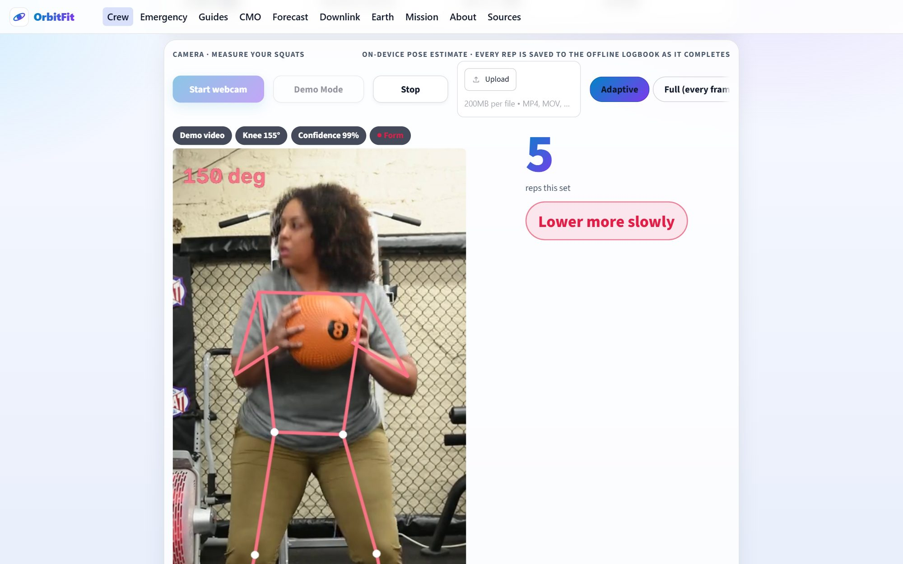 **Camera workout:** pose tracking counts every rep | 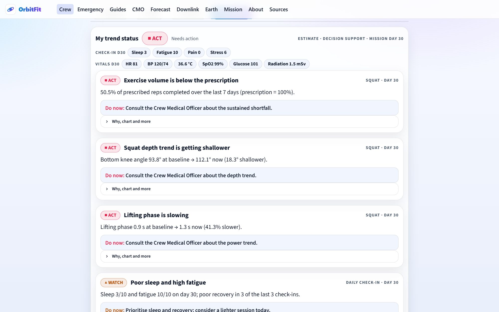 **Alerts:** what changed, and one thing to do now |
| 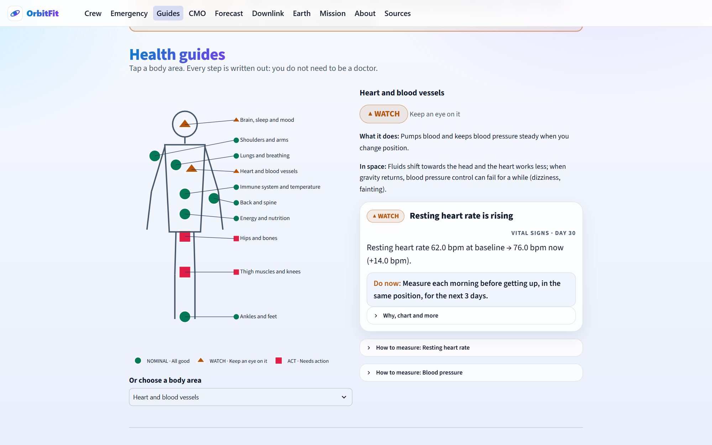 **Health guides:** a clickable body map and how-to steps | 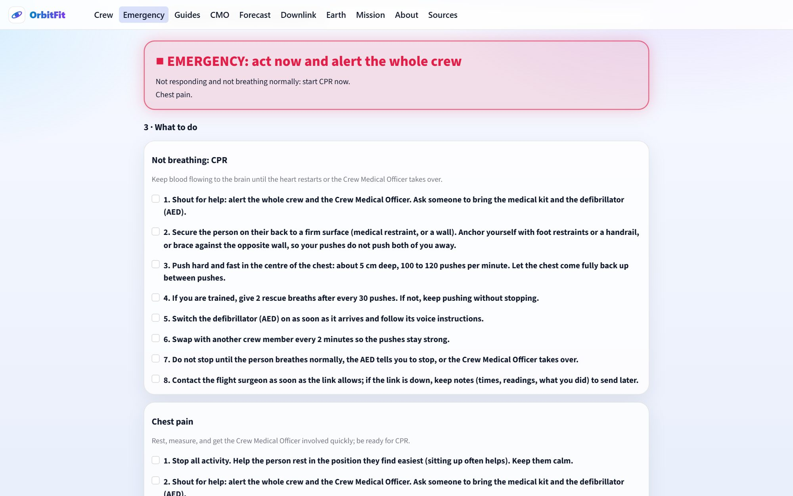 **Emergency:** CPR steps adapted to microgravity |
| 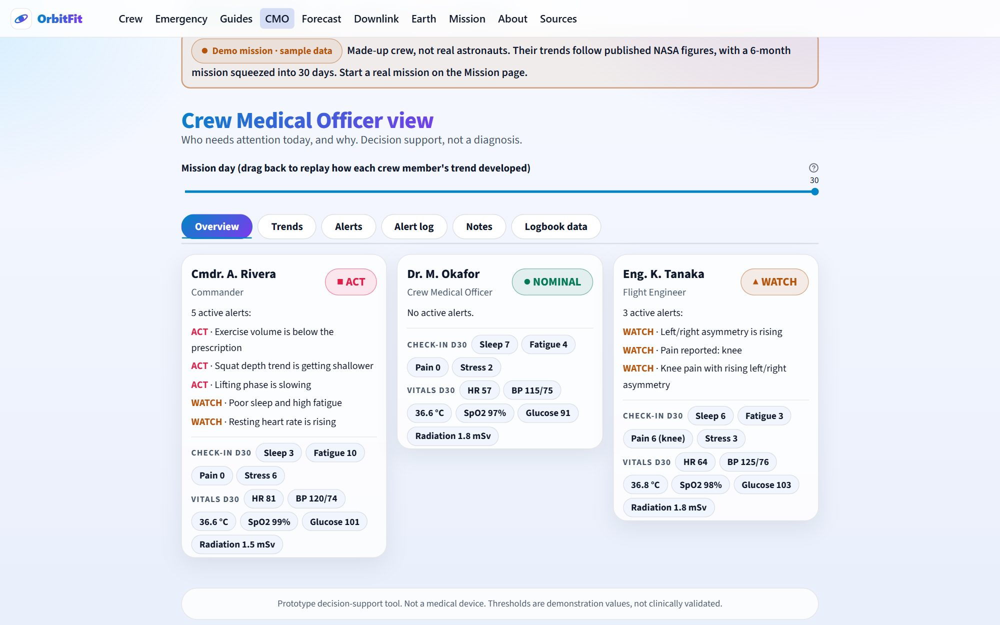 **Crew Medical Officer:** the whole crew at a glance | 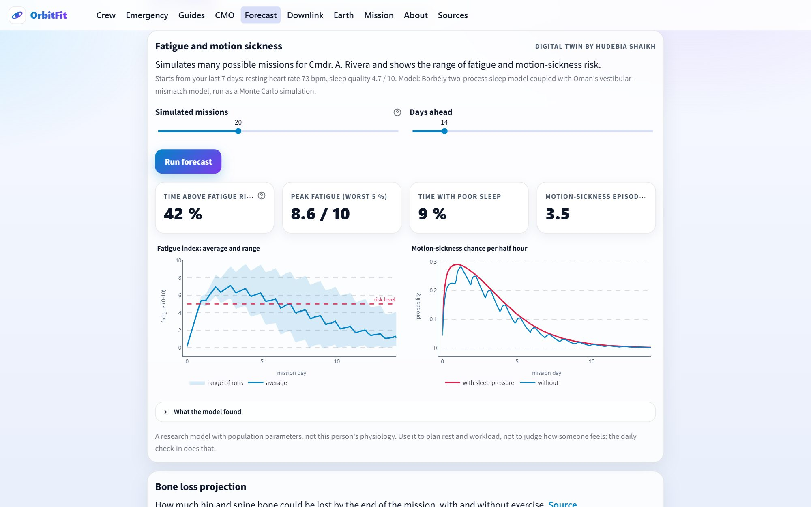 **Forecast:** a digital twin of fatigue and motion sickness |
| 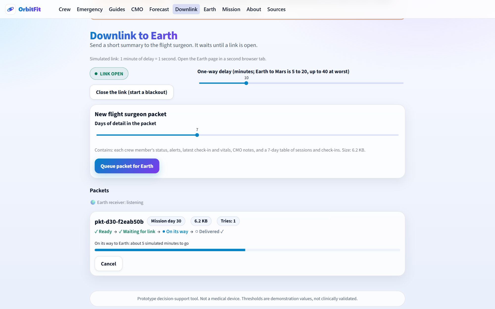 **Report to Earth:** waits through blackouts, sends when the link opens | 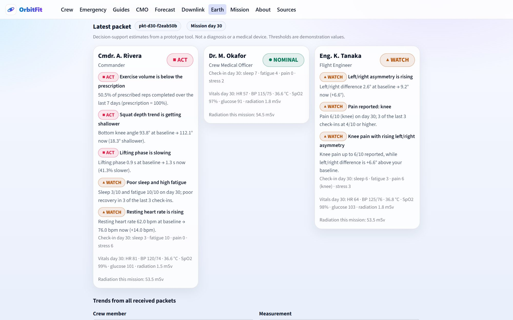 **Earth receiver:** what the flight surgeon sees |

## Features

| Page | For | What it gives |
|---|---|---|
| **Crew** | Astronaut | Status (● NOMINAL / ▲ WATCH / ■ ACT), today's routine and streak, then 1 · Check-in, 2 · Vitals, 3 · Workout (camera), 4 · My status |
| **Emergency** | Any crew member | Yes/no questions → a priority and step-by-step guides (CPR, chest pain, breathing, bleeding, stroke, seizure, allergy, head injury) for microgravity, Moon/Mars or Earth |
| **Guides** | Astronaut | A clickable body map with each area's status, and how to measure every indicator, why it matters in space, what is normal and what to do if not |
| **CMO** | Crew Medical Officer | Crew overview with a mission-day replay, trends against each person's baseline, alerts, alert log, notes |
| **Forecast** | Crew and CMO | A digital twin (fatigue, sleep and motion-sickness risk), a bone-loss projection, daily energy needs |
| **Downlink / Earth** | Astronaut / flight surgeon | A small summary packet queued until a comms window opens, with delay, blackouts and acknowledgement (simulated), and the ground side that receives it |
| **Mission** | Everyone | Mission details, crew, CSV export/import, daily backups, start over |
| **About / Sources** | Judges | How it works, limitations, every NASA reference |

- **Vital signs:** resting heart rate, blood pressure, temperature, blood sugar, oxygen saturation and the day's
  radiation dose from the personal dosimeter.
- **Radiation:** a storm-shelter alert for a day far above the deep-space background, and the mission total against
  NASA's 600 mSv career limit.
- **Camera workout:** knee angle from 3D pose points, rep counting, depth, tempo, left/right difference and one plain
  cue ("Good depth", "Lower more slowly"). Video never leaves the computer.
- **Gravity:** the exercise plan and the emergency steps change with the location: Earth, ISS, deep-space transit,
  Moon, Mars or a custom gravity.
- **Personal alerts:** each person's own baseline; every alert says what changed, why it matters in space (with a
  NASA source) and what to do.
- **Offline and private:** one SQLite logbook on the computer; no account, no cloud, no usage statistics.

## How to run locally

You need **Python 3.11 or 3.12** ([python.org](https://www.python.org/downloads/); on Windows tick *Add python.exe to
PATH*). The first start needs internet once to install the packages; after that OrbitFit runs fully offline.
A webcam is optional: **Demo Mode** plays a bundled squat video.

**1. Get the code:** on GitHub, **Code → Download ZIP** and unzip it, or:

```bash
git clone https://github.com/syedhassaan10/Astronaut-Health-Monitor-NASA-SPACE-APP-CHALLENGE-2026.git
```

**2. Start it**

| System | Easiest | By hand |
|---|---|---|
| **Windows** | Double-click `start.bat` | See below |
| **macOS / Linux** | `bash start.sh` in the folder | See below |

Windows (PowerShell, inside the folder):

```powershell
python -m venv .venv
.venv\Scripts\python.exe -m pip install -r requirements.txt
.venv\Scripts\python.exe -m streamlit run app.py --server.address localhost
```

macOS / Linux (terminal, inside the folder):

```bash
python3 -m venv .venv
.venv/bin/python -m pip install -r requirements.txt
.venv/bin/python -m streamlit run app.py --server.address localhost
```

**3. Open it:** the browser opens http://localhost:8501 by itself (if not, open that address). Choose
**Open the demo** for 3 sample crew members with 30 days of history.

The app only listens on this computer: no health data is served to the network.

**If something goes wrong**

| Problem | Fix |
|---|---|
| `python` is not found | Install Python 3.11 or 3.12 and tick *Add to PATH*, then open a new window |
| MediaPipe fails to install | Use Python 3.11 or 3.12 (MediaPipe has no wheels for newer versions yet) |
| "Could not open the camera" | Another app is using it, or there is no webcam: use **Demo Mode** |
| Port 8501 is busy | Add `--server.port 8502` to the run command |

## Try it in 2 minutes

1. **Crew → 3 · Workout → Demo Mode.** A sample squat video plays; reps are counted and saved as they happen.
2. **Location (top of the page) → Moon.** The workout plan changes (weight, tempo, volume).
3. **Emergency:** answer "Do they answer? → No" and "Breathing normally? → No". Switch the location between ISS and
   Moon: the CPR steps change.
4. **Guides:** with Cmdr. Rivera selected, click the knees and the heart on the body map.
5. **CMO:** drag the mission-day slider back to day 8 and forward to day 30.
6. **Forecast:** press **Run forecast**.
7. **Downlink:** open the **Earth** page in a second browser tab. Queue a packet, press *Open a comms window*, and
   watch it arrive on Earth.

## How it works

- **Pose:** MediaPipe pose estimation runs on the device; knee angles come from 3D points, so "up" does not matter
  in microgravity.
- **Reps and form:** a rep detector with hysteresis measures depth, tempo and left/right difference. Battery saving
  runs the model on about 1 frame in 7, plus every frame around each turning point.
- **Health rules:** each person's baseline is the median of their first 3 valid sessions; recent medians are compared
  with it. Check-in, vital-sign and radiation rules sit alongside. All thresholds are in one file,
  [config/health_rules.py](config/health_rules.py).
- **Forecast:** Hudebia Shaikh's digital twin, a Monte Carlo of the Borbély sleep model coupled with a vestibular
  (motion-sickness) model, in [digital_twin/](digital_twin/).
- **Logbook:** every rep is saved to SQLite the moment it ends, so a crash loses nothing.

## NASA data and resources

The health indicators, the "why it matters in space" text on every alert and guide, and the exercise model are based
on NASA Human Research Program risk pages (muscle, bone, cardiovascular, immune, nutrition, hypoxia, CO2, sleep,
behavioural health, in-flight medical conditions) and NASA technical reports on ISS exercise countermeasures.
Radiation limits come from NASA-STD-3001 (600 mSv career limit) and Curiosity's RAD measurements on the way to Mars
(1.8 mSv a day). The demo crew data is synthetic, but its trends follow published NASA figures (up to 30% leg
strength loss without enough exercise, 9% with the ARED device, 1-1.5% bone loss per month); see
[data/nasa_evidence.py](data/nasa_evidence.py). Every source is listed in [guidance/sources.py](guidance/sources.py)
and on the app's Sources page.

## Project structure

| Folder | Contents |
|---|---|
| `app.py` | Entry point: page menu and theme |
| `pages/`, `ui/` | The Streamlit pages and shared widgets |
| `engine/` | Rep detector, form scoring, gravity engine, health, check-in, vitals and radiation rules, emergency triage |
| `config/` | All health thresholds in one file |
| `digital_twin/` | Fatigue, sleep and motion-sickness forecast; bone-loss projection |
| `pose/` | MediaPipe loader, camera tracker, overlay, session recorder |
| `db/` | SQLite logbook, CSV import/export, backups |
| `downlink/` | Packet builder, simulated link, sender and Earth receiver |
| `guidance/` | Measurement guides, body map, daily routine, NASA sources |
| `data/` | Crew, locations, demo data, NASA figures |
| `assets/` | Pose model and demo clip (bundled, so nothing is downloaded at run time) |
| `docs/` | Screenshots, videos and the submission text |
| `tests/` | 327 automated tests |

## Tests

```bash
python -m pytest -q
```

327 tests cover the pose maths, rep detector, form scoring, gravity engine, every health, vitals and radiation
rule, emergency triage, the digital twin, demo data, CSV round trip, the logbook, the downlink (retry, blackout,
duplicates), the real pose model on the demo clip, every page rendering, and the offline and wording rules.

## Settings

| Setting | How |
|---|---|
| Health thresholds | Edit [config/health_rules.py](config/health_rules.py) |
| Logbook file | `ORBITFIT_DB` (default `var/orbitfit.db`) |
| Simulated link and Earth inbox | `ORBITFIT_LINK_DB`, `ORBITFIT_EARTH_DB` (default in `var/`) |
| Skip the setup and open the demo | `ORBITFIT_START_WITH_DEMO=1` |
| Start over (new mission or demo) | Mission page → Start over |

## Limitations

- Prototype, not a medical device. Thresholds are demonstration values.
- Vital signs and radiation doses are typed in; OrbitFit does not connect to medical devices or dosimeters.
- Camera estimates depend on placement, light and clothing. Squat and deadlift are measured; heel raise has a plan
  only.
- The forecasts are models with population parameters, not measurements of the person.
- The exercise device load, the Earth link and the demo crew are simulated.
- The emergency guides follow common first-aid steps and never replace the onboard medical procedures, the Crew
  Medical Officer or the flight surgeon.

## Credits

- **Pose model:** MediaPipe Pose Landmarker (lite) by Google, CC BY 4.0.
- **Demo clip:** "A Woman Doing Squats" by Julia Larson, via Pexels (Pexels License).
- **CPR steps:** follow the 2025 American Heart Association guidelines.

## Team and licence

Syed Hassaan Areeb Kazmi (Team Owner), Azam Tariq (Developer), Mohammad Bin Javed (Developer), Hudebia Shaikh
(Developer), Eman Fatima (UI/UX Designer). MIT License, see [LICENSE](LICENSE).
